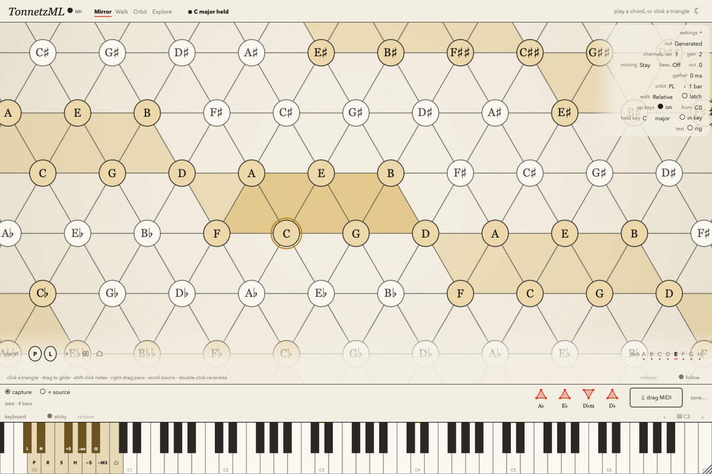

# TonnetzML

*Tonnetz / Musical Lattices.* A VST3 (and Standalone) for macOS that makes new chords from the
ones you play by moving them on the Tonnetz, the lattice of fifths and thirds, and sends them out
as MIDI. The plan, with the theory, the design and the status of each phase, is [PLAN.md](PLAN.md).



## What it does

A chord you play (on a keyboard, from a MIDI clip, or by clicking the lattice) is placed on the
Tonnetz. A **word** `W` of lattice operations turns it into a new chord, voiced close to the one
you played, which goes out as MIDI on its own channel:

| Op | What it does to a triad |
|----|-------------------------|
| **P** L R | flip through the fifth (C → Cm), the minor third (C → Em), the major third (C → Am) |
| N S H | R L P, L P R, L P L as one step |
| +5 −5 +M3 −M3 +m3 −m3 | move the whole chord a fifth, a major third or a minor third |
| Flip, Pivot | reflect through any two tones / through one tone |
| Grow, Shrink | add the tone across an edge (C → Cmaj7, C → Am7) / take it away again |

Four ways to drive `W` (the **Mode**):

- **Mirror:** `W` is one of eight stored slots (A–H; factory P, L, R, N, PL, PR, LR, S). Every chord comes out
  transformed the same way.
- **Walk:** the **operator keys** (an octave, C0–B0 by default: P L R N S H +5 −5 +M3 −M3 Undo Home)
  each add one op. Hold a chord with the right hand and walk it across the lattice with the left.
- **Orbit:** the host clock steps a cycle (PL, PR, LR, PLR or the slot's word) every Rate (1/4 bar to
  4 bars) while a chord is held or latched.
- **Explore:** the editor: click a ghost neighbour to add its op, click a triangle to play it.

It also listens for the **key** (Temperley's profiles over what you play): the lattice tints the
key's notes, names and numerals are spelled in it, *In key* marks the moves that stay in it, and
the exported MIDI file carries its key signature.

## In Live

Rescan plug-ins (*Settings → Plug-Ins → Rescan*, with *Use VST3 Plug-In System Folders* on).
TonnetzML is under *Plug-Ins → VST3 → Alistair Rutherford*. Put it on a MIDI track; on an
instrument track choose *MIDI From: (that track) → TonnetzML* and arm it or set Monitor to *In*.
Source notes go out on channel 1 (with *Mix: Source + Generated*), generated ones on channel 2.

To hear it with nothing routed (and in the Standalone, where it is on by default), turn on
**Preview tone** (*settings → sound*): a small built-in voice plays what TonnetzML sends, and
hovering a ghost neighbour auditions it.

## The editor

- **The lattice** is the window. Click a triangle to play its triad, drag to glide, shift-click
  nodes to build any chord. Right-, ⌘- or middle-drag (or two fingers) pans; the wheel or a pinch
  zooms; double-click recentres. The source chord is teal, the generated one vermilion.
- **Ghost neighbours** around the generated chord name the ops one step away; hover to hear
  (with Preview tone), click to add (Walk, Explore).
- **Free ops** on the generated chord: click one of its nodes to **Pivot** on it, the middle of one
  of its edges to **Flip** through it, a node marked **+** across an edge to **Grow** into it. They go
  where the word bar's edits go (Walk's `W`, or the slot's word in Mirror).
- **The word bar** shows `W` as chips: `+` opens a palette laid out as the lattice (with −g for
  Shrink), drag chips to reorder, drop one off to delete, double-click to type a word (`P L +5`).
- **The capture strip**: every chord played, as a glyph. **⦿ capture** arms a take (otherwise the
  last 64 bars are kept anyway); click a glyph to play that chord again; drag **⇩ drag MIDI** into a
  track or the Finder for a `.mid` (hold Alt for the *Chords* version, one block chord per change on
  the sixteenth grid); **save…** writes one.
- **The keyboard strip** shows both inks and the operator zone; click to play (*sticky* holds keys
  until clicked again), or use the computer keyboard (Z… and Q… rows, ‹ › for the octave).

Saved with the set: every parameter, the eight slot words, the current `W` (and Orbit's step), the
latched chord, and the editor's view (camera, zoom, theme, Follow, Sticky, the settings column,
the computer keyboard's octave). The capture is not saved.

## Build and install

Needs macOS 12 or later, Xcode, and [JUCE 8.0.14](https://github.com/juce-framework/JUCE) at
`~/Development/JUCE` (or pass `--juce DIR`).

```bash
Tools/install.sh
```

builds the VST3 and the Standalone (Release, arm64 + x86_64) in `dist/build`, signs them ad hoc
and installs them for the current user:

- `~/Library/Audio/Plug-Ins/VST3/TonnetzML.vst3`
- `~/Applications/TonnetzML.app`
- `~/Music/TonnetzML/TestRig/` (the test rig's folder, see below)

`--validate` also runs pluginval at strictness 10, `--no-build` installs the last build again,
`--uninstall` removes the plug-in and the app. Nothing needs a password. Live keeps a VST3's code
in memory for its whole session: restart Live to try a new build.

To work on it in Xcode, open `TonnetzML.jucer` in Projucer and save, or use the generated
`Builds/MacOSX/TonnetzML.xcodeproj`.

## Tests

| Command | What it runs |
|---------|--------------|
| `Tests/run_tests.sh` | The core tests (lattice, ops against an independent Python reference, voicing, engine, Orbit, key, fuzz, editor commands, capture, Preview tone). `Source/core` is header-only C++17 with no JUCE, so this needs only clang. |
| `Tests/run_snapshot.sh` | A console app around the real processor and editor: reference images of the editor against `Tests/fixtures/snapshot` (`--update` rewrites them), hit-testing, every parameter's control, the capture and drag-out, state, no allocation on the audio thread. |
| `Tests/run_validation.sh` | pluginval, strictness 10, on the installed VST3. |
| `LiveBridge/tests/phase*.py` | The checks in Live (PLAN.md §7.4), through the ClaudeLiveBridge Remote Script on port 9873. |

### The test rig

For checks in a host. With the **Test rig** parameter on, the plug-in reads
`~/Music/TonnetzML/TestRig/Keys.txt` and plays its keys as if they came from the host, on the
sample, while the transport runs:

```
# beat note velocity length     (beats are quarter notes from the start of the song)
4 60 100 2
4 64 100 2
4 67 100 2
```

Up to 512 keys; the file is read again when it changes. `Status.txt` beside it says what was
loaded and played, the word, the chords, the key and the capture. `Tests/build/render_scenario`
renders the same file offline, as the plug-in would play it.

## Layout

```
TonnetzML.jucer   Source/core/{lattice,engine,theory,midiio} (JUCE-free)   Source/plugin   Source/ui
Tests/            run_*.sh, test_*.cpp, render_scenario.cpp, FakeHost.h, Snapshot/ (the snapshot app)
Tools/            install.sh, gen_lattice_fixture.py, gen_key_fixture.cpp
LiveBridge/tests/ the Live checks
docs/             screenshots
```
